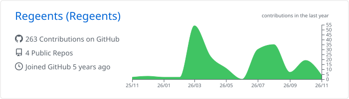
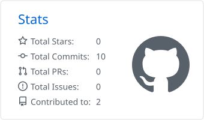
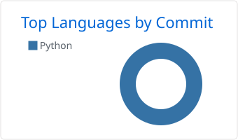

# Regeents

**Full Stack Developer** · Next.js · Node.js · TypeScript · Python

---

### About

Full stack developer focused on the JavaScript and TypeScript ecosystem, building efficient, scalable web applications and community-driven tools. I also work with Python, and I'm currently exploring Rust.

### Stack

  

**Currently learning**

  

### GitHub Stats

<picture>
  <source media="(prefers-color-scheme: dark)" srcset="./profile-summary-card-output/github_dark/0-profile-details.svg" />
  
</picture>

<picture>
  <source media="(prefers-color-scheme: dark)" srcset="./profile-summary-card-output/github_dark/3-stats.svg" />
  
</picture>
<picture>
  <source media="(prefers-color-scheme: dark)" srcset="./profile-summary-card-output/github_dark/2-most-commit-language.svg" />
  
</picture>

<picture>
  <source media="(prefers-color-scheme: dark)" srcset="https://streak-stats.demolab.com?user=Regeents&theme=github-dark-blue&hide_border=true&background=0D1117" />
  
</picture>

### Top Languages (Last 30 Days)

<!--START_SECTION:waka-->

| Language | Usage | Share |
| :--- | :--- | ---: |
| **TypeScript** | `████████░░░░░░░░` | **—** |
| **JavaScript** | `█████░░░░░░░░░░░` | **—** |
| **Python** | `███░░░░░░░░░░░░░` | **—** |

<!--END_SECTION:waka-->
